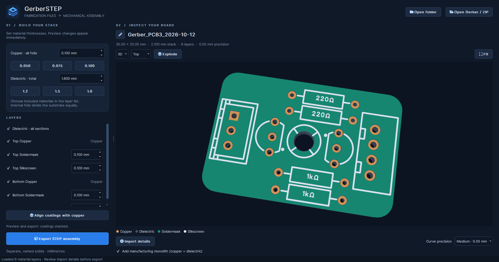

# GerberSTEP
<div align="center">
  
</div>

A PyQt6 desktop app that turns a Gerber fabrication set into a coloured STEP
assembly with separate copper, dielectric, soldermask and silkscreen components.

## Run on this machine

Double-click **launch.bat**. The local `.venv` already contains the dependencies.

1. Choose **Open folder** and select `examples/demo` to try the included board.
2. Adjust thicknesses or disable individual soldermask/silkscreen layers.
3. Choose **Export STEP assembly**.

You can also run `.venv\Scripts\python.exe main.py examples\demo` from this folder.

## Fresh installation

Use Python **3.12, 64-bit** (the tested runtime). CadQuery includes a large native
CAD dependency, so the first installation downloads several hundred megabytes.

```powershell
py -3.12 -m venv .venv
.\.venv\Scripts\python.exe -m pip install -e ".[test]"
.\.venv\Scripts\python.exe main.py
```

On Linux/macOS, use `python3.12 -m venv .venv` and `.venv/bin/python` instead.
The UI uses Qt's native window system; a functioning desktop session is required.

## Layer controls

| Material | Default | Controls |
| --- | --- | --- |
| Copper | 0.100 mm per foil | Numeric input; 0.050 / 0.075 / 0.100 mm presets; individual layer checkboxes |
| Dielectric | 1.600 mm total | Numeric input; 1.2 / 1.5 / 1.6 mm presets; checkbox for all sections |
| Soldermask | 0.100 mm per layer | Individual top/bottom checkbox and thickness |
| Silkscreen | 0.100 mm per layer | Individual top/bottom checkbox and thickness |

Dielectric thickness means **total insulating material**, excluding all copper.
For multilayer boards, equal dielectric sections separate internal foils in
numeric layer order. A two-sided board with the defaults has a 2.2 mm overall
stack: 1.6 mm substrate plus 0.1 mm each for two copper, two mask and two silk
layers. Missing surface files do not create artificial layers.

Use the pencil to the left of the board name to edit the suggested STEP filename.
ZIP imports use the ZIP filename, without its extension. Renaming does not change
the source files, and survives precision rebuilds.

Every material can be disabled in the layer list, including copper and dielectric.
For a silk-only export, leave only the desired silkscreen checked. Disabling core
materials preserves the board's layer heights. An empty selection disables export.

**Align coatings with copper** moves exported mask and silk to the same substrate surface
plane as outer copper. Top coatings extend upward and bottom coatings downward.
Their own thicknesses are retained, so solids can overlap in this mode. It is
intended for the requested machining workflow. The preview always keeps coatings
stacked, regardless of this export-only option. STEP components stay separate.

## Precision and manufacturing body

**Curve precision** controls the maximum chord error used to approximate circles
and arcs in the outline, artwork and drill holes. It affects both preview and
export geometry, not just display quality.

| Preset | Chord error | Intended trade-off |
| --- | --- | --- |
| Low | 0.10 mm | Fewest faces and simplest machining paths |
| Medium (default) | 0.05 mm | Balance of curve accuracy and face count |
| High | 0.01 mm | Original accuracy; most faces |

Changing precision rebuilds the open fabrication set in the background. Thickness,
enabled layers, coating alignment and camera position are preserved. Larger chord
errors visibly facet small holes and pads; choose the tolerance your job permits.

**Add manufacturing monolith** is enabled by default. Export adds an extra component
named `Manufacturing_Monolith`, containing one Boolean-fused copper/dielectric solid.
It retains copper trace relief, outline cutouts and drill holes. Mask and silk are
excluded. The original material components remain in the same STEP assembly.

For machining, select `Manufacturing_Monolith` and hide the original layer components
so the overlapping duplicates are not part of your machining model. The preview
continues to show the material layers, without drawing a duplicate over them.
Disable the checkbox to export only the original components. Disconnected boards
or unconnected stacks cannot form one monolith; the app reports an error rather than
silently exporting a multi-solid compound as a monolith. Fusion adds export time,
particularly at High precision.
If the selection does not contain both copper and dielectric, the monolith option
is disabled and no monolith is exported. It never restores layers you disabled.

## Preview

Switch between **3D** (drag to orbit, middle-drag to pan, scroll to zoom) and
**2D** (top or mirrored bottom view).
Double-click or press **Fit** to reset the camera. **Explode** separates layers
only in the preview and never changes export heights. The desktop 3D renderer
uses OpenGL with retained mesh buffers: rotation updates camera matrices, while
thickness and exploded-view changes update component transforms. Geometry and
colours are uploaded only when a material mesh changes. A working OpenGL driver
is required for interactive 3D. Headless screenshot tests use the software path.

Both previews use the same planar geometry and layer settings as the STEP
export, except for the export-only coating alignment. Loading, geometry preparation and
STEP writing run in a worker thread. Controls are locked while a job runs; the
window waits for that job before allowing closure.

## Input and geometry assumptions

- Open a folder or ZIP containing **one board**. Selecting an individual Gerber
  loads companion files from its folder. Drag-and-drop is also supported.
- Standard Gerber naming is detected by Gerbonara, including `.gtl/.gbl`,
  `.gts/.gbs`, `.gto/.gbo`, `.gko` and KiCad layer names. Unrecognized naming needs
  standard filenames; there is no manual layer mapping UI yet. Review **Import
  details** for parser warnings and recognized source files.
- A closed board outline is required. Outline cutouts and Excellon through holes
  and routed slots are subtracted from the material layers. Open outlines are
  rejected. Blind/buried via depths, plated barrels, edge plating, components,
  solder paste and fabrication drawings are not modeled.
- Standard soldermask Gerbers represent **openings**, so mask material is their
  complement within the board. Material-positive mask files must be inverted
  upstream. Legacy `%IPNEG*%` files are rejected; use a modern RS-274X export.
- Curves are polygonized with the **selected chord tolerance**. STEP contains valid
  extruded B-rep solids with faceted curves, not analytic cylindrical holes.
  This is a geometric reconstruction, not recovery of a manufacturer's stackup.

The assembly has one named, coloured component per material layer or dielectric
section. Disconnected copper islands remain separate solids inside that layer's
compound. Export validates each solid and writes through a temporary file so a
failed CAD operation does not replace an existing destination file.
When enabled, the manufacturing monolith is an additional fused component.

## Validation

```powershell
.\.venv\Scripts\python.exe -m pytest -q
```

Tests cover Gerber polarity and aperture holes, arcs, outline cutouts, drills,
ZIP and companion-file loading, stack heights, optional layers, multilayer
ordering, Qt controls and asynchronous import. STEP is reopened through
OpenCascade and checked for solid validity, dimensions, names and volume.
Fixtures are synthetic; production fabrication sets still need comparison with
their original board designs.

`scripts/create_demo.py` regenerates the demonstration fabrication files.
`scripts/capture_preview.py` renders the actual Qt window to `output/` for visual
inspection. Windows offscreen rendering explicitly loads system Arial because
that backend does not enumerate system fonts automatically.

`scripts/benchmark_gpu.py` opens a brief native test window and records rotation
latency and mesh-upload counts in `output/gpu-benchmark.json`. The demo measured
4.17 ms median and 4.33 ms at the 95th percentile on an RTX 4060 Ti, with zero
mesh uploads during 90 camera rotations. Larger boards will have different timings.

Windows startup registers a dedicated application identity and loads a
multi-resolution `.ico` for both the application and window. Restart the app after
updating to apply the taskbar identity. `scripts/build_icon.py` regenerates the
icon from the SVG source.

Core libraries: [Gerbonara](https://gerbolyze.gitlab.io/gerbonara/),
[CadQuery](https://cadquery.readthedocs.io/en/stable/), PyQt6, QtAwesome, Shapely
and NumPy, plus PyQtGraph/PyOpenGL for the GPU preview. The layered PCB logo is an
editable SVG in `gerberstep/assets/`.

## Windows and Linux executable builds

Build on the target OS; PyInstaller does not cross-compile Windows/Linux binaries.
Use a 64-bit Python 3.12 environment on either platform:

```text
python -m pip install -r requirements.txt
python -m pip install -e ".[build,test]"
python scripts/build.py
```

Outputs:

| Host | Executable | Portable archive |
| --- | --- | --- |
| Windows | `dist/windows/GerberSTEP.exe` | `dist/GerberSTEP-windows.zip` |
| Linux | `dist/linux/GerberSTEP` | `dist/GerberSTEP-linux.tar.gz` |

Distribute just the executable, or its archive. Python, Qt, CAD libraries, icons
and the demo set are embedded; no Python installation or `_internal` folder is
needed. The executable extracts its bundled dependencies to a temporary directory
at startup, so launching can take longer than a folder build and requires free
temporary disk space.
Builds are unsigned. Linux requires working system OpenGL/EGL libraries and a Qt
desktop platform; Ubuntu CI installs these dependencies in `.github/workflows/build.yml`.
The Linux build targets Ubuntu 24.04 or a compatible/newer glibc environment.

Run the **Build desktop executables** GitHub Actions workflow manually (or push a
`v*` tag) to build both platforms. Each job runs tests and a packaged STEP export
smoke test before uploading its archive. Linux archives preserve executable permissions.
No workflow is dispatched automatically by the local build script.

The bundled diagnostic command `GerberSTEP --self-test report.json` tests icons,
Qt imports, Gerber parsing and a STEP round trip, writing a JSON report. Use
`QT_QPA_PLATFORM=offscreen` for a headless check. It does not test GPU rendering.
